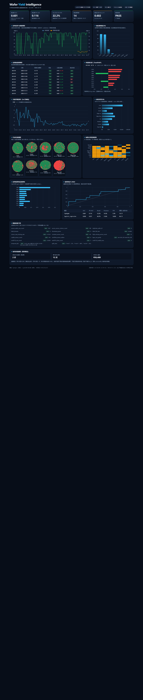
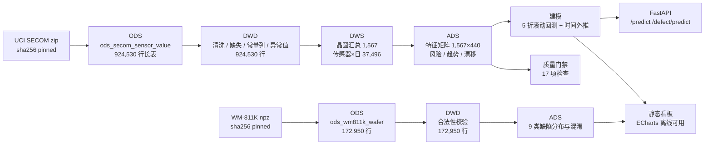

# Wafer Yield Intelligence

半导体晶圆良率风险预警 + 晶圆缺陷图谱分类的**端到端、可复现**工程样例：分层数仓（ODS→DWD→DWS→ADS）、数据质量门禁、时间外推建模、SHAP 归因、FastAPI 服务与离线看板。

> 数据与指标均为真实运行结果，未做任何美化。SECOM 时间外推 AUC **0.601**（95% CI 0.375–0.817），9 类缺陷 Macro-F1 **0.602**。局限与代价在[模型说明](docs/model.md)中如实说明。

[](https://github.com/Jamorlant/wafer-yield-intelligence/actions/workflows/ci.yml)




## 业务背景

封装测试环节中，一片晶圆要经过数百道工序、上千个传感器参数。良率异常往往不是单点故障，而是**多个参数同步漂移**的结果。业务上真正贵的不是"多判了几片"，而是**失效晶圆漏检后流入下游**：一次 escape 的代价通常是单片价值的数倍到数十倍，而一次误报复判只消耗少量工程与机台时间。

因此本项目把问题定义为：**在固定的误报预算（FPR=5%）下，尽可能提高失效晶圆的召回率**，并给出每片晶圆的参数级归因，让工程师知道"为什么这片被判高风险"。

对应到岗位：这是典型的半导体大数据开发场景——多源数据接入、分层建模、质量门禁、时序特征、模型服务与业务看板。

## 数据来源与许可

| 数据集 | 来源 | 许可 | 规模 | 用途 |
| --- | --- | --- | --- | --- |
| SECOM | [UCI ML Repository id 179](https://archive.ics.uci.edu/dataset/179/secom) | CC BY 4.0 | 1,567 片 × 590 传感器 + 时间戳 + 良/不良标签 | 良率预测、参数归因 |
| WM-811K（派生特征子集） | [公开 GitHub 镜像](https://github.com/ililllilll/WM811K) | CC0（原始 WM-811K） | 172,950 片 × 26 维几何/缺陷特征，9 类 | 缺陷图谱分类 |

说明与取舍：

- SECOM 失效 104 片，失效率 **6.64%**，严重不平衡；本项目不做 SMOTE 过采样，改用类别权重 + 固定误报预算下的阈值，避免合成样本污染时间序列。
- WM-811K 原始 `LSWMD.pkl` 含 811,457 张晶圆图，体量大且 Kaggle 下载需凭证。本项目使用公开镜像中的 **26 维派生特征表**（行数 172,950，仅保留有标签样本），并**沿用官方 Training/Test 划分**（54,355 / 118,595），不重新随机切分。这不是原图 CNN 方案，局限见 [模型说明](docs/model.md)。
- 两个数据集均通过 `sha256` 固定版本，下载脚本自动校验；仓库不提交原始数据（见 `.gitignore`）。

## 架构



分层理由：数据量只有 92 万行，铺满四层不是为了性能，而是为了让**职责边界**清楚——ODS 保留原始语义、DWD 只做可审计的清洗、DWS 沉淀可复用粒度、ADS 面向应用。每层都有行数与口径校验，出问题能快速定位在哪一层。

## 真实结果

### 良率预测（SECOM，时间外推）

| 指标 | 数值 | 说明 |
| --- | --- | --- |
| 切分 | 1,097 / 235 / 235 | 按测量时间 70/15/15，测试期 2008-10-05 ~ 10-17 |
| 可用特征 | 440 | 剔除 116 个常量、32 个缺失率 >40% 的传感器后 |
| 选型回测 | LightGBM 0.585±0.150；逻辑回归 0.572±0.141 | 5 折扩展窗口，选中 LightGBM |
| 测试期 AUC | **0.601**（95% CI 0.375–0.817） | 单次留出，样本仅 9 片失效 |
| 测试期 PR-AUC | **0.116** | 随机基线 0.038 |
| Recall @ 5% FPR | **22.2%** | 14 条预警命中 2 片失效，实际 FPR 5.3% |
| 归因 | TreeSHAP | Top 驱动：S060、S034、S461、S022、S091 |

业务情景测算（假设明确写在配置里，不是已实现收益）：避免 2 片失效流出 × 单片 3,000 元 × 10 倍流出成本 = 60,000 元，扣除 12 次误报 × 300 元复判成本，**净价值 +56,400 元**。

### 缺陷分类（WM-811K 派生特征，9 类）

| 指标 | LightGBM | 逻辑回归 |
| --- | --- | --- |
| Accuracy | 93.7% | 86.7% |
| Balanced Accuracy | **63.4%** | 61.1% |
| Macro-F1 | **0.602** | 0.499 |

注意：测试集中 `none` 占 93.3%，所以 Accuracy 几乎等于"全判合格"的基线，**没有参考价值**；真正有意义的是 Macro-F1 / Balanced Accuracy。`Scratch`、`Loc` 是最难的两类（F1 0.087 / 0.427）。

### 数据质量门禁

17 项检查全部 PASS，包括：行数/列数、主键重复、标签域、时间可解析、失效率、缺失率、常量列、非有限值、层间行数一致、时间切分严格有序等。报告见 `artifacts/quality_report.json`。

## 快速开始

```bash
# 1) 安装依赖（Python 3.13）
pip install -r requirements.txt

# 2) 一条命令跑完：下载 → 数仓 → 质量门禁 → 良率模型 → 缺陷模型 → 看板
python -m src.cli all

# 3) 打开看板（纯静态，无需服务）
#    dashboard/index.html
#    或启动 API：python -m src.cli serve  →  http://127.0.0.1:8000/docs
```

分步执行：

```bash
python -m src.cli download            # 下载并校验 sha256
python -m src.cli warehouse --no-resume
python -m src.cli quality             # 失败返回码 1
python -m src.cli train
python -m src.cli defect
python -m src.cli dashboard
python -m src.cli serve --port 8000
```

## 目录结构

```
.
├── configs/config.yaml          # 唯一配置源：路径、阈值、超参、业务假设
├── sql/                         # ODS / DWD / DWS / ADS / meta 建表与加工 SQL
├── src/
│   ├── cli.py                   # python -m src.cli <download|warehouse|quality|train|defect|dashboard|serve|all>
│   ├── ingest/                  # 下载、sha256 校验、SECOM / WM-811K 解析
│   ├── warehouse/               # 分层构建、指纹、断点续跑
│   ├── features/                # 传感器画像、清洗、衍生特征、时间切分
│   ├── quality/                 # 17 项质量规则与报告
│   ├── modeling/                # 回测、指标、良率模型、缺陷模型、归因
│   ├── serving/app.py           # FastAPI：/health /model/info /predict /defect/predict /wafer/{id}
│   └── dashboard/               # 单文件 HTML + 本地 ECharts + JSON 导出
├── tests/                       # pytest：特征、质量、指标、API 合约
├── dashboard/index.html         # 已生成的看板（可直接打开）
├── Dockerfile                   # API 镜像
└── .github/workflows/ci.yml     # ruff + pytest
```

## 工程化要点

- **幂等与断点续跑**：`meta_pipeline_run` / `meta_pipeline_step` 记录每次运行；配置+数据指纹一致时复用已完成步骤，`--no-resume` 强制重跑。
- **质量门禁**：校验不过 `quality` 返回非 0，`all` 会中止，避免脏数据进入模型。
- **时间外推**：禁止随机切分；模型对比使用扩展窗口回测，阈值从 OOF 分数按 5% FPR 冻结后只对测试期使用一次。
- **可解释**：LightGBM 用原生 TreeSHAP（`pred_contrib`），逻辑回归用标准化系数，两者都是精确加性归因。
- **测试**：18 个 pytest 用例覆盖特征工程、质量规则、指标边界（Recall@FPR、业务价值、bootstrap）与 API 合约。
- **CI**：GitHub Actions 在 Python 3.13 上执行 `ruff check` + `pytest`，不依赖原始数据。
- **容器**：提供 API 镜像（`docker build -t wafer-yield .`）。本机未安装 Docker，镜像未做构建验证；训练产物通过 volume 挂载。
- **CI 状态**：GitHub Actions 已真实跑通（lint + 18 个测试）。

## 局限与下一步

1. SECOM 只有 1,567 片、3 个月，时间外推方差极大（AUC 95% CI 0.37–0.82）。当前结果**只能证明方法与工程闭环，不足以直接上线**。
2. 缺陷模型基于 26 维派生特征，不是原图；生产方案应上 CNN/ViT + 晶圆图，并补充 die 级坐标。
3. 缺少 lot_id、设备 commonality、recipe 版本，无法做设备/批次的根因下钻。
4. 业务价值是情景测算，真实收益需要复判成本、escape 成本与产线节拍数据。

## 文档

- [业务说明](docs/business.md)：良率损失链路、指标口径、看板怎么读
- [模型说明](docs/model.md)：切分、回测、阈值、指标、归因、失败模式
- [数据字典](docs/data_dictionary.md)：表结构、字段、质量规则
- [面试讲解稿](docs/interview_guide.md)：10 分钟口径，含"为什么做/数据/方法/结果/价值/局限"

## 许可

代码 MIT（见 [LICENSE](LICENSE)）。数据集许可见 [NOTICE](NOTICE)：SECOM CC BY 4.0，WM-811K CC0，ECharts Apache-2.0。
