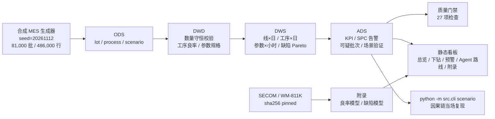

# Wafer Yield Intelligence

> **本仓库主演示使用 100% 合成数据，不是真实产线数据。**
> 真实 MES/EAP 数据受保密协议（NDA）限制，无法带出或公开。合成数据使用固定随机种子（`seed: 20261112`），
> 字段结构与真实 MES 导出完全同构，指标可复现，但数值不代表任何真实工厂。
> 替换为真实导出只需改数据源层：见 [MES 数据契约与替换路径](docs/mes_schema.md)（`mes.source: synthetic → export`），
> 下游 DWD / SPC / 看板逻辑不变。

封装测试良率与设备异常 BI 的**端到端、可复现**工程样例：分层数仓（ODS→DWD→DWS→ADS）、SPC 规则预警、异常剧本与告警一致性验证、离线三屏看板；附录保留 UCI SECOM 良率模型与 WM-811K 缺陷分类。


> 主演示：合成 MES，3 条线 / 90 天 / 81,000 批 / 486,000 行 → 4 条 SPC 告警、2 个注入剧本全部 MATCH。
> 附录真实数据：SECOM 时间外推 AUC **0.601**（95% CI 0.375–0.817），9 类缺陷 Macro-F1 **0.602**。
> 局限与代价在[模型说明](docs/model.md)与[指标口径](docs/metric_definitions.md)中如实说明。

[](https://github.com/Jamorlant/wafer-yield-intelligence/actions/workflows/ci.yml)


## 业务背景

封装测试环节中，一批晶圆要经过多道工序、每道工序数十个设备参数。良率异常往往不是单点故障，而是**某个设备、某个班次、某个参数先漂移，几小时后才反映到良率**。业务上真正贵的是**异常发现太晚**：等到终检良率掉下来，已经有一批批次流过。

因此本项目把问题定义为：**在小时级参数上做 SPC 判异，把「参数先漂 → 工序良率下降 → 最终良率下降」的因果链提前暴露出来，并落到设备与批次**。

对应到岗位：多源数据接入、分层建模、质量门禁、规则预警、业务看板与角色化交付。

## 数据来源与许可

| 数据集 | 来源 | 许可 | 规模 | 用途 |
| --- | --- | --- | --- | --- |
| **合成 MES（主演示）** | `src/synthetic/mes.py` 固定种子生成 | 本项目代码生成，无第三方数据 | 81,000 批 × 6 工序 = 486,000 行 | 三屏 BI、SPC 预警、因果链验证 |
| SECOM（附录） | [UCI ML Repository id 179](https://archive.ics.uci.edu/dataset/179/secom) | CC BY 4.0 | 1,567 片 × 590 传感器 + 时间戳 + 标签 | 良率预测、参数归因 |
| WM-811K 派生特征（附录） | [公开 GitHub 镜像](https://github.com/ililllilll/WM811K) | CC0（原始 WM-811K） | 172,950 片 × 26 维特征，9 类 | 缺陷图谱分类 |

说明与取舍：

- **合成 MES 的边界**：字段、粒度、数量守恒、班次与设备编号都按真实 MES 建模；但异常是**注入**的（2 个剧本），不是真实事故。剧本与告警的对应关系见下文「因果链」。
- 合成数据在看板**首屏顶部横幅**明确标注，不藏在角落；质量门禁 `mes_source_labelled` 会检查声明是否存在。
- SECOM 失效 104 片，失效率 **6.64%**，严重不平衡；不做 SMOTE，改用类别权重 + 固定误报预算下的阈值。
- WM-811K 使用公开镜像的 **26 维派生特征表**，沿用官方 Training/Test 划分（54,355 / 118,595），不是原图 CNN 方案。
- 两个公开数据集均通过 `sha256` 固定版本，下载脚本自动校验；仓库不提交原始数据。

## 架构



真实接入时，只需把 `S` 换成 `data/raw/mes_export/{lots,process}.csv`，`O1` 之后的所有层与看板不变。

分层理由：铺满四层不是为了性能，而是让**职责边界**清楚——ODS 保留原始语义、DWD 只做可审计的校验、DWS 沉淀可复用粒度、ADS 面向应用。每层都有行数与口径校验，出问题能定位到层。

## 真实结果（全部由 `python -m src.cli all` 跑出）

### 主演示：合成 MES 三屏 BI

| 指标 | 数值 | 说明 |
| --- | --- | --- |
| 数据规模 | 81,000 批 / 486,000 工序行 / 90 天 | 3 线 × 3 班 × 100 批/班 × 6 工序 |
| 看板快照 | 2026-11-09（数据至 11-10） | 停在告警当天，不用未来数据自我安慰 |
| 全线日良率 | **93.96%** | 目标 94.5%，缺口 -0.54pp |
| LINE-B 日良率 | **92.91%**（7 日均 93.72%） | 较 7 日均 **-0.81pp**，当班 2 条告警，状态 `alert` |
| SPC 告警 | **4 条**，全部可追溯到注入剧本 | R1 3σ ×2、R2 连续 7 点 ×2，未追溯告警 0 条 |
| 场景验证 | **2 / 2 MATCH** | `ads_mes_scenario_check`，5 项 check 全真 |
| 数据质量门禁 | **27 / 27 PASS** | 含 MES 10 项：行数、数量守恒、口径一致、场景↔告警一致、来源标注 |

### 因果链：注入的异常与看板预警对得上

S1（快漂移，演示主角）：

| 环节 | 时间 | 滞后 | 证据 |
| --- | --- | --- | --- |
| 参数开始漂移 | 2026-11-09 00:00 | — | LINE-B / DIE_ATTACH / **EQ-DA-02** / `bond_temp`（键合温度） |
| 参数越 3σ | 2026-11-09 03:00 | 3.0h | z ≥ 3，**夜班 NIGHT** 首受影响 |
| 工序良率首降 | 2026-11-09 03:00 | 3.0h | DIE_ATTACH 工序良率相对基线 -3.96pp |
| 看板产生预警 | 2026-11-09 05:00 | 5.0h | **R1_3SIGMA**（连续 3 点越界，severity high） |
| 最终良率下降 | 2026-11-09 06:00 | 6.0h | 批次最终良率 -3.45pp，8 小时回溯 71 个可疑批次 |

S2（慢漂移，暴露检测短板）：

| 环节 | 时间 | 滞后 | 证据 |
| --- | --- | --- | --- |
| 参数开始漂移 | 2026-10-20 00:00 | — | LINE-A / MOLD / **EQ-MD-01** / `mold_pressure`（模压压力） |
| 工序良率首降 | 2026-10-21 05:00 | 29.0h | 夜班，工序良率 -2.77pp |
| 参数越 3σ | 2026-10-22 03:00 | 51.0h | 连续 7 点同侧且偏移 ≥ 2σ |
| 看板产生预警 | 2026-10-22 03:00 | 51.0h | **R2_SEVEN_POINT**（severity medium） |
| 最终良率下降 | 2026-10-27 05:00 | 173.0h | 最终良率 -3.22pp |

这两条链可用一条命令当场复现：

```bash
python -m src.cli scenario          # 打印整条链
python -m src.cli scenario --json   # 结构化输出，便于对照看板
```

S2 的「参数越 3σ 晚于工序良率首降」是真实短板，不是 bug：缓慢漂移下良率连续响应，3σ 只是报警阈值。这也正是 R2 连续 7 点规则存在的理由；检测滞后 51h 说明慢漂移仍需更灵敏的方法。

### 附录：SECOM 良率模型（时间外推）

| 指标 | 数值 | 说明 |
| --- | --- | --- |
| 切分 | 1,097 / 235 / 235 | 按测量时间 70/15/15，测试期 2008-10-05 ~ 10-17 |
| 可用特征 | 440 | 剔除 116 个常量、32 个缺失率 >40% 的传感器 |
| 选型回测 | LightGBM 0.585±0.150；逻辑回归 0.572±0.141 | 5 折扩展窗口 |
| 测试期 AUC | **0.601**（95% CI 0.375–0.817） | 单次留出，仅 9 片失效 |
| 测试期 PR-AUC | **0.116** | 随机基线 0.038 |
| Recall @ 5% FPR | **22.2%** | 14 条预警命中 2 片失效，实际 FPR 5.3% |
| 缺陷分类 Macro-F1 | **0.602** | WM-811K 派生特征 9 类，Balanced Accuracy 63.4% |

业务情景测算（假设写在配置里，不是已实现收益）：避免 2 片失效流出 × 3,000 元 × 10 倍流出成本 = 60,000 元，扣除 12 次误报 × 300 元，**净价值 +56,400 元**。

## 快速开始

```bash
# 1) 安装依赖（Python 3.13）
pip install -r requirements.txt

# 2) 一条命令跑完：下载 → 数仓(含 MES) → 质量门禁 → 场景验证 → 模型 → 看板
python -m src.cli all

# 3) 打开 dashboard/index.html（纯静态、离线可用）
#    或启动 API：python -m src.cli serve  →  http://127.0.0.1:8000/docs
```

分步执行：

```bash
python -m src.cli download            # 下载并校验 sha256
python -m src.cli warehouse --no-resume
python -m src.cli quality             # 失败返回码 1
python -m src.cli scenario            # 注入异常 ↔ 告警因果链
python -m src.cli train
python -m src.cli defect
python -m src.cli dashboard
python -m src.cli serve --port 8000
```

## 目录结构

```
.
├── configs/config.yaml          # 唯一配置源：数据源、均线/产品/工序参数、SPC、注入剧本
├── sql/                         # 00-03 SECOM/WM-811K；10-13 MES ODS→DWD→DWS→ADS
├── src/
│   ├── cli.py                   # <download|warehouse|quality|scenario|train|defect|dashboard|serve|all>
│   ├── synthetic/mes.py         # 确定性合成 MES 生成器（固定 seed）
│   ├── ingest/                  # 下载校验、SECOM/WM-811K 解析、MES 导出接入
│   ├── warehouse/               # 分层构建、指纹、断点续跑、MES 加工与场景验证
│   ├── quality/spc.py           # SPC 基线、标准化、R1/R2 判异（纯函数）
│   ├── quality/checks.py        # 27 项质量门禁
│   ├── modeling/                # 回测、指标、良率模型、缺陷模型、归因
│   ├── serving/app.py           # FastAPI：/predict /defect/predict
│   └── dashboard/               # 单文件 HTML + 本地 ECharts + JSON 导出
├── tests/                       # 33 个 pytest：生成器/SPC/质量/指标/看板/API
├── dashboard/index.html         # 已生成的看板（可直接打开）
├── docs/                        # 业务、模型、数据字典、MES 契约、指标口径、Agent 路线
├── Dockerfile                   # API 镜像
└── .github/workflows/ci.yml     # ruff + pytest
```

## 工程化要点

- **确定性**：合成数据 `numpy.random.default_rng(seed)`，同一 seed 的 `digest` 与逐行数量完全一致，`tests/test_synthetic.py` 守护。
- **口径可重算**：良率从 `output_qty / input_qty` 重算，不读生成器里的良率列；`mes_route_yield_parity` 校验批次头与工序链一致。
- **幂等与断点续跑**：`meta_pipeline_run` / `meta_pipeline_step` 记录运行；配置+数据指纹一致时复用，`--no-resume` 强制重跑。
- **质量门禁**：校验不过 `quality` 返回非 0，`all` 中止；场景未全部 MATCH 或存在未追溯告警时 `scenario` 返回非 0。
- **时间外推**：禁止随机切分；模型对比用扩展窗口回测，阈值从 OOF 分数按 5% FPR 冻结后只对测试期使用一次。
- **可解释**：LightGBM 用原生 TreeSHAP；每条 SPC 告警都带参数、基线、控制限、z 值与建议动作。
- **测试与 CI**：33 个 pytest 覆盖生成器不变量、SPC 规则边界、质量规则、指标计算、看板 JSON 结构与 API 合约；GitHub Actions 执行 ruff + pytest。
- **容器**：提供 API 镜像（`docker build -t wafer-yield .`）。本机未安装 Docker，镜像未做构建验证。

## 局限与下一步

1. **合成数据不是真实事故**：异常是注入的，因果链证明的是「规则能抓到这种形态」，不是「真实产线一定这样」。
2. **慢漂移检测滞后**：S2 用了 51h 才发现，最终良率滞后 173h；需要 EWMA/CUSUM 或多参数联合判异。
3. **覆盖范围有限**：只覆盖封测 6 道工序、每道 5 个参数；真实机台参数数百个，且需要 recipe 版本与停机数据。
4. **SECOM 方差极大**：1,567 片、3 个月，测试期 AUC 95% CI 0.37–0.82，只能证明方法与工程闭环，不足以直接上线。
5. **缺陷模型不是原图**：基于 26 维派生特征，生产方案应上 CNN/ViT + 晶圆图与 die 级坐标。

## 文档

- [MES 数据契约与替换路径](docs/mes_schema.md)：真实导出列契约、切换步骤、已知边界
- [指标口径](docs/metric_definitions.md)：良率/FPY/RTY、SPC 规则、场景验证、门禁
- [Agent 路线](docs/agent_roadmap.md)：L0→L3、护栏、角色视图
- [业务说明](docs/business.md)：良率损失链路、看板怎么读
- [模型说明](docs/model.md)：切分、回测、阈值、指标、归因、失败模式
- [数据字典](docs/data_dictionary.md)：表结构、字段、质量规则

## 许可

代码 MIT（见 [LICENSE](LICENSE)）。数据集许可见 [NOTICE](NOTICE)：SECOM CC BY 4.0，WM-811K CC0，ECharts Apache-2.0。
